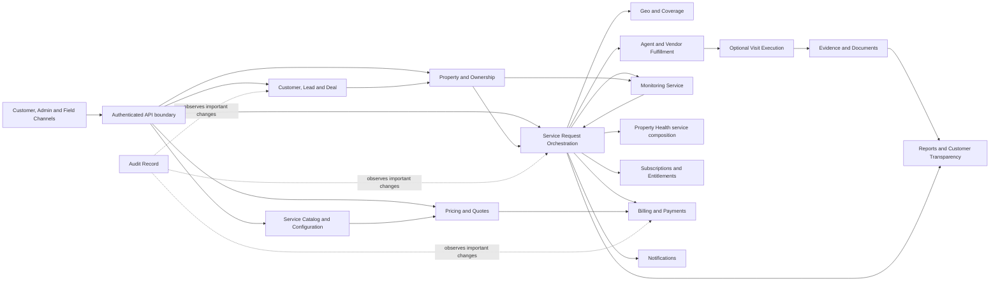
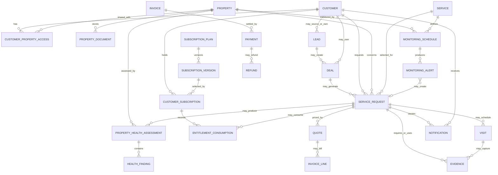

# PropertyPilot Architecture Truth

**Version:** 1.0  
**Status:** Authoritative target architecture  
**Business authority:** [`docs/Business/PROPERTY_PILOT_BUSINESS_TRUTH.md`](docs/Business/PROPERTY_PILOT_BUSINESS_TRUTH.md)

## 1. Authority and scope

This document defines the target structure of PropertyPilot’s software architecture. It supplements the Business Truth; it does not redefine business policy. Where the two conflict, Business Truth prevails. Code inventories and audit reports describe the present repository and inform reuse, but do not override either truth document.

PropertyPilot is a property lifecycle management platform. PropertyPilot owns the customer relationship, service offer, customer price, service quality, SLA, evidence, reporting, billing, and customer communication. Customers purchase from PropertyPilot. Agents, vendors, and partners are fulfillment resources operating behind the PropertyPilot brand.

Property Health Check is a service category within the service model, not a separate platform silo. Monitoring is a service with recurring or event-driven execution. Leads and deals support opportunity management; neither turns PropertyPilot into a marketplace.

## 2. Architecture shape

The core application is organized around explicit business domains and stable domain interfaces. Domain ownership is more important than deployment boundaries: the initial implementation may deploy as a modular application, with each domain owning its rules, application operations, persistence mappings, and events. A domain must not modify another domain’s data by bypassing its application interface. Independently deployable services are introduced only where operational scale, isolation, or team ownership requires them; domain contracts remain the same.

The primary data store holds transactional domain records. Files and media are held in controlled object storage, with metadata, ownership, retention, integrity and version information held in the data store. Cross-domain work that must survive process failure is represented as durable workflow state and published through an outbox or equivalent transactional event mechanism. External payment, messaging, identity, and geo providers sit behind adapters.

The diagram shows logical responsibility, not a required number of deployable applications.

## 3. Domain architecture

### 3.1 Customer and identity

Identity authenticates people and grants role-based capabilities. Customer is the business relationship owned by PropertyPilot. A customer profile is distinct from a user login; a customer may have multiple authorized users in future without changing property or service ownership semantics. Existing customers, prospects, and staff-created customers converge into the same customer lifecycle when an actual customer relationship is established. Lead qualification may occur before a customer or property exists.

Customer-owned views aggregate authorized properties, service requests, visits, evidence, reports, subscriptions, entitlements, invoices, payments, alerts, and savings. Customer access is checked against the resource and property ownership/access relationship, not solely against possession of an identifier.

### 3.2 Property and ownership

Property is the primary business asset and the anchor for operational history. A property has a flexible type and location and may have one or more owners. Ownership/access is an explicit relationship with role, validity period, and provenance where needed. Property records connect documents, service requests, monitoring schedules, assessments, visits, evidence, and reports.

Operational work normally requires a property. Lead qualification is the permitted exception before a property is known. Property types are data-driven so residential, commercial, land, and agricultural variants do not require domain redesign.

### 3.3 Service catalog and configuration

Every customer-facing capability is represented as a PropertyPilot service in a configurable catalog. The catalog owns service identity, category, description, availability, chargeability, default SLA, pricing inputs, eligibility, and execution requirements. Service categories include compliance, legal/document, inspection, tenant, advisory, monitoring, and Property Health Check services.

Each service’s effective configuration determines at least:

- Whether a visit is required, whether it is mandatory, and the allowed visit count.
- Required evidence types and validation conditions.
- Whether GPS verification is required and the acceptable location policy.
- Eligibility and geographic coverage.
- SLA targets, priority behavior, and completion conditions.
- Pricing and allowed subscription, coupon, cluster, ETA, or promotional benefits.

Configuration is versioned and auditable. A request keeps the effective service/configuration version that governed it, so later catalog edits do not silently change work already sold.

### 3.4 Service request orchestration

Service Request is the customer work order and the principal execution aggregate. It links a customer, property, selected service and service-configuration version, accepted price/entitlement, current status, SLA timestamps, and auditable status history. It coordinates pricing acceptance, payment or entitlement, assignment, optional visits, evidence validation, completion/reporting, notifications, and cancellation/refund outcomes.

The request owns lifecycle transitions. Assignment and visit components own their own sub-lifecycles and report outcomes to the request. A status change records actor, timestamp, prior and new state, and reason. Request creation validates that the customer can act for the property and that the service is available for that property’s location.

### 3.5 Agent and vendor fulfillment

Agents, vendors, and partners are operational fulfillment resources selected by PropertyPilot. They do not own the customer relationship, customer price, or customer-facing SLA. Agent capabilities, service capabilities, availability, coverage, assignment and execution are represented separately from customer-facing service definitions.

Vendor identity and cost may be stored for procurement and settlement. Customer-facing responses and reports present PropertyPilot as the accountable service provider and do not expose vendor complexity unless a defined business process requires disclosure.

### 3.6 Visit execution

Visit is a child execution record created only when the selected service configuration requires or schedules one. A service without a visit proceeds directly through its configured non-visit execution and evidence path. A request may have multiple visits up to its configured maximum. Visits carry schedule, assigned resource, state, start/end times, location capture, notes and linked evidence.

The visit lifecycle cannot by itself mark the service request complete. Request completion evaluates the entire configured requirement set, including all visits, evidence, approvals, required documents, and payment/entitlement conditions.

### 3.7 Evidence and documents

Evidence is proof that a particular service activity occurred. Evidence is linked to its request and, where applicable, visit and property. It records evidence type, uploader/actor, capture time, storage key, checksum, content type, validation state and audit history. Supported types include before/after photographs, video, GPS verification, documents, signatures and service-specific evidence.

Evidence lifecycle states distinguish upload/capture, validation, acceptance, rejection and supersession. Completion consumes accepted evidence satisfying the effective service rules; mere file existence is not approval.

The Document domain manages property, service, evidence and generated report documents, including type, versions, ownership/access, retention and audit metadata. Document bytes are stored separately from metadata and are accessed through scoped, time-limited operations. Reports retain provenance to the property, service request, assessment and evidence used to produce them.

### 3.8 Lead and deal management

Lead is an opportunity record, not an asset for sale and not a billable deliverable by default. It captures source, contact/prospect context, interest, owner, qualification state and activities. Lead may be associated with an existing customer or remain external; it may convert to a customer, create a deal, or close without revenue.

Deal tracks a revenue opportunity, customer intent, negotiation and proposed service scope. It is not a marketplace transaction. A deal may originate from a lead, an existing customer, or an administrator. A deal may create zero or more service requests. Deal completion does not substitute for the service request’s execution, evidence, or payment lifecycle.

### 3.9 Pricing and quotes

Pricing is owned by PropertyPilot and driven by versioned, administrator-managed rules. Vendor cost is an input; customer price is the output. A quote records the inputs, selected rule/configuration versions, standard price, customer price, discounts, tax, currency, expiry and acceptance. A quote accepted for a request is immutable for that purchase; repricing creates a new quote and requires customer acceptance where the payable amount changes.

Pricing supports vendor cost, travel cost, agent allowance, overhead, margin, GST/tax, subscription benefit, coupon, cluster, ETA and promotional discounts. Discount eligibility, ordering, caps, stacking, rounding and effective dates are configuration, not scattered hardcoded branches. Customer views expose standard price, customer price and savings without exposing internal operational cost breakdown.

Every service has an explicit price or an explicit applicable benefit/discount that offsets it. Subscription entitlements and bundled services are recorded as consumption/benefit application, not an untraceable free request.

### 3.10 Subscriptions and entitlements

Subscription Plan and version define benefits, service entitlements, discount rules, priority and bundle terms. Customer Subscription links a customer to the accepted plan version, dates, renewal preference and lifecycle state. Entitlement balances/limits and consumption are explicit ledger entries tied to a service request or other eligible use.

Activation and renewal follow confirmed payment or a recorded authorized no-charge entitlement. Renewal work is idempotent and records success or failure; failed payment does not grant a new paid period. Add-ons are separately priced service benefits linked to the subscription/customer and billed or discounted under explicit rules.

### 3.11 Monitoring

Monitoring is an ongoing PropertyPilot service linked to a property, customer, service definition, coverage and active subscription or purchase. A monitoring schedule defines frequency or event triggers, scope, next run, SLA and lifecycle. Each execution produces observations/evidence and an outcome. An outcome may create a customer alert, recommendation or follow-on service request, with links back to the monitoring schedule and property.

Monitoring lifecycle and alerts are auditable. Monitoring is delivered to the customer as a PropertyPilot service; providers and field resources remain internal fulfillment details.

### 3.12 Property Health Check

Property Health Check is implemented through the service catalog and service-request execution model. It is not a separate platform module or parallel customer lifecycle. A Property Health Check request composes applicable document, compliance, physical and risk checks. Components may be performed independently as separate services.

An assessment result is linked to the property and request and contains dated findings, evidence/document references, health and risk scores where defined, recommendations and service opportunities. Its generated report records the underlying check/configuration versions and source evidence. Score calculations and checklists are versioned business configuration.

### 3.13 Geo intelligence

Geo Intelligence manages service coverage zones, clusters, property coordinates, agent territories/capabilities, geo eligibility, visit GPS validation and distance/travel inputs. It is shared domain capability used by property, catalog, assignment, visit, monitoring and pricing operations. Geo requirements are selected by service configuration. GPS rules include acceptable accuracy, capture conditions and validation outcome; distance pricing uses a defined, auditable method.

### 3.14 Notifications

Notification owns PropertyPilot’s status communication to customers, agents and administrators. Domain events trigger template-driven messages for request, assignment, visit, evidence, completion, subscription, monitoring, health, payment, complaint and SLA events. Templates and channel preferences are configuration. Delivery is recorded with recipient, template version, channel, provider reference, attempt state and final outcome. Notifications do not own business lifecycle state.

### 3.15 Payments, billing and refunds

Payment and Billing record amounts owed and settlement state for services, subscriptions and add-ons. Invoice lines reference accepted quote/plan values and tax; payment records contain method, provider reference, status and idempotency key. Payment success is based on verified provider settlement, not a client assertion. Refunds include full or partial amount, reason, provider reference, approval/actor, status and linkage to the original payment/invoice.

Financial state transitions are auditable and reconciled against provider events. Service completion, subscription activation/renewal and entitlement consumption follow the applicable payment or authorized benefit policy.

### 3.16 Administration and configuration

Administration is an operator-facing capability over domain-owned configuration and operations. Administrators manage service definitions, service requirement versions, pricing, subscription plans, eligibility, geo coverage, agents/vendors, monitoring policies, notification templates, reports, payment/refund operations and access roles. Ordinary business-rule changes are versioned, validated, approved where policy requires, activated, and audited without code deployment.

Admin APIs and screens are separate access surfaces from customer and field operations. Authorization is explicit by role and resource scope. Admin actions use the same domain application interfaces as other channels rather than writing domain tables directly.

## 4. Domain relationships

`CUSTOMER_PROPERTY_ACCESS` represents ownership or an explicitly granted property relationship; one customer may access many properties and one property may have multiple owners/authorized customers. A property may have many service requests over its lifecycle. A request may have zero visits when its service does not require one. All request, visit, evidence, quote, invoice, payment, assessment and alert records retain their property/customer context directly or through an enforced relationship.

## 5. Lifecycle flows

### 5.1 Lead lifecycle

`CAPTURED → QUALIFYING → QUALIFIED → (CUSTOMER_LINKED and/or DEAL_OPENED) → CONVERTED or CLOSED`

Lead source and contact may be external, customer-originated, agent-originated or administrator-created. A lead can close as unqualified or inactive without creating a customer, deal, request or revenue. Conversion preserves the lead’s activity history and references the resulting customer/deal.

### 5.2 Deal lifecycle

`OPEN → QUALIFICATION → PROPOSAL/NEGOTIATION → WON or LOST/CANCELLED`

The deal records scope, potential value, decision history and participants. On an authorized won/accepted outcome, the deal may create one or more separately identified service requests. Each request receives its own service configuration, quote, delivery evidence, completion and settlement records.

### 5.3 Service request lifecycle

`CREATED → ASSIGNED → IN_PROGRESS → COMPLETED`

Additional business states are `ON_HOLD`, `REJECTED`, and `CANCELLED`. Assignment acceptance is recorded on the assignment; a request may remain assigned until work begins. Resume/reassignment behavior is explicit and auditable. Creation resolves the service/property/customer, validates access and coverage, freezes the effective configuration and accepted price/entitlement, and records whether payment is required. Completion is allowed only when all configured execution, evidence, report/approval, SLA and financial/entitlement conditions are satisfied. Every transition records actor, time, prior state, new state and reason.

### 5.4 Visit lifecycle

`PLANNED → SCHEDULED → IN_PROGRESS → COMPLETED`

Alternative terminal outcomes include `CANCELLED` and `FAILED`; rescheduling and no-show are recorded outcomes where supported. Visits are created only where required or operationally chosen within configured limits. A visit’s terminal state is evidence for request completion, not equivalent to request completion.

### 5.5 Evidence lifecycle

`CAPTURED/UPLOADED → QUARANTINED/VALIDATING → ACCEPTED`

Validation may instead produce `REJECTED`, with reason and permitted resubmission/supersession. Evidence retains uploader, type, capture and upload timestamps, property/request/visit association, checksum, media metadata, storage reference, validation decision and audit history. Completion uses accepted evidence meeting the request’s frozen service requirements.

### 5.6 Subscription lifecycle

`PENDING_PAYMENT → ACTIVE → (PAUSED ↔ ACTIVE) → RENEWAL_DUE → RENEWED/ACTIVE`

Alternative endings/outcomes include `PAYMENT_FAILED`, `EXPIRED`, and `CANCELLED`. Plan version and entitlements are fixed for the subscription period except through an explicit upgrade/change transaction. Confirmed payment or an explicit zero-pay benefit precedes activation or renewal. Consumption is ledgered against eligible requests; renewal failure does not silently extend paid entitlement.

### 5.7 Monitoring lifecycle

`CONFIGURED → ACTIVE → RUN_DUE/RUNNING → OBSERVATION_RECORDED → (ALERTED and/or FOLLOW_UP_REQUESTED) → ACTIVE`

Schedules may be periodic or event-triggered. Exceptions include `PAUSED`, `FAILED`, `EXPIRED`, and `CANCELLED`. Each run is idempotently identified and records time, source, observation/evidence, result and next action. Alerts may be acknowledged/resolved, and follow-up work is a linked service request.

### 5.8 Payment lifecycle

`CREATED → PENDING/AUTHORIZATION_REQUIRED → AUTHORIZED → CAPTURE_PENDING → SUCCEEDED`

Alternative results include `FAILED`, `CANCELLED`, `EXPIRED`, `REFUND_PENDING`, `PARTIALLY_REFUNDED`, and `REFUNDED`. Provider callbacks are authenticated and idempotently applied. Invoice balance and entitlement/service state derive from confirmed payment or documented benefit application; client-supplied status never establishes settlement. Each refund is a linked, separately audited financial transaction.

## 6. Business rules

1. PropertyPilot is **not a marketplace**. Deals are PropertyPilot revenue opportunities and not buyer/seller marketplace transactions.
2. Vendors and partners are internal fulfillment resources. PropertyPilot owns the customer relationship, pricing, SLA, quality and service outcome; vendor complexity is hidden from the customer unless an explicit business rule requires disclosure.
3. Every customer-facing activity is offered and tracked as a PropertyPilot service.
4. Every service has a chargeable price unless an explicit discount, entitlement or other recorded benefit offsets that charge.
5. Not every service requires a visit. A service’s effective configuration decides whether a visit is required and how many may occur.
6. Visit, evidence, GPS/geo verification, eligibility, SLA and completion rules are configured per service and versioned for each request.
7. Pricing is administrator-configurable and rule-driven. Operational cost components remain internal; customers see standard price, customer price and savings.
8. Monitoring is a customer service associated with a property and may create alerts and follow-on service requests.
9. Property Health Check is a service category implemented through the service catalog and service request model, not a separate platform lifecycle.
10. Leads may originate from a current customer, non-customer/prospect, agent, website/mobile channel, referral, campaign, walk-in or administrator. A lead need not become a customer or produce revenue.
11. Deals may originate from leads, existing customers or administrators and may generate multiple service requests.
12. Property is the primary business asset. Operational records link to a property except during lead qualification before the property is known.
13. Completion requires every configured business condition to pass; evidence must be validated, associated with the correct work and retained with provenance.
14. Every material business, operational, configuration and financial action records who acted, when, what changed and why.
15. Customer status, visit history, evidence, reports, pricing benefits, savings and property history are exposed only to authorized customers and staff.

## 7. Architecture principles

### Configuration over hardcoding

Business variation belongs in versioned service, pricing, evidence, visit, geo, SLA, notification and entitlement configuration. Code implements the rule engine and validation mechanism; configuration supplies the service-specific policy.

### Audit everything

Business transitions and privileged configuration changes carry actor, timestamp, previous/current values and reason. Audit history is linked to the affected customer, property, request or financial transaction and cannot be silently overwritten.

### Evidence-based operations

Execution outcomes are supported by typed, validated, access-controlled evidence. Evidence metadata and reports preserve provenance to the work and property they prove.

### SLA-driven execution

Services and requests carry effective SLA targets and timestamps. Assignment, execution, hold, breach, escalation and resolution are measurable and visible to authorized operations and customers.

### Customer ownership by PropertyPilot

PropertyPilot is the customer-facing service provider and communication owner. Access to records follows customer/property ownership and authorized operational assignment. Agents/vendors do not become independent customer accounts for the purchased service.

### Scale-ready architecture

Domain APIs are stateless where possible; long-running workflows have durable state and idempotent transitions; list/read operations are bounded and indexed; media is stored outside the transactional database; configuration and integration boundaries permit multiple cities, service categories, properties and visits without domain redesign. Capacity decisions are validated against measured workload before adding distributed infrastructure.

## 8. Current repository alignment reference

This section records structures present in the inventories used to prepare this target architecture; it does not assert that every target behavior is implemented.

| Target domain | Existing code structures named by current inventory |
|---|---|
| Customer and identity | `CustomerEntity`, `UserEntity`, `AuthServiceImpl`, `UserServiceImpl`, `SecurityService` |
| Property and ownership | `Property`, `PropertyOwnerEntity`, `PropertyServiceImpl`, `PropertyOwnerServiceImpl` |
| Service catalog and eligibility | `ServiceEntity`, `ServiceEligibilityRuleEntity`, `EligibilityEngineImpl` |
| Service request workflow | `ServiceRequestEntity`, `ServiceRequestStatusHistoryEntity`, `ServiceRequestServiceImpl` |
| Agent and visits | `AgentEntity`, `AgentAssignmentEntity`, `AgentAssignmentServiceImpl`, `VisitEntity`, `VisitServiceImpl` |
| Evidence and documents | `EvidenceEntity`, `GpsVerificationEntity`, `EvidenceServiceImpl`, `CompletionValidationServiceImpl`, `DocumentServiceImpl`, `DocumentVersion` |
| Lead and deal | `LeadEntity`, `LeadActivityEntity`, `DealEntity`, `DealServiceImpl`, deal participant/activity/milestone entities |
| Pricing and subscriptions | pricing profile/rule/estimate/line-item entities and pricing services; subscription plan/version/entitlement/consumption/renewal entities and services |
| Billing and payments | `InvoiceEntity`, `PaymentEntity`, `RefundEntity`, `BillingServiceImpl`, `PaymentServiceImpl` |
| Monitoring and notifications | `MonitoringScheduleEntity`, `MonitoringAlertEntity`, `NotificationEntity`, `SubscriptionNotificationEntity`; subscription schedulers |
| Geo intelligence | coverage/cluster/location entities and repositories; `GpsVerificationServiceImpl` |
| Administration and reporting | pricing configuration/rule controllers, domain admin endpoints, dashboard/report services |

The current repository inventory identifies no Property Health Assessment aggregate, no monitoring service/controller workflow, and no active customer-facing web/mobile/admin application matching the target channels. Those are statements about the inspected repository snapshot, not changes to the business model.

## 9. Change control

Changes to this architecture must remain consistent with Business Truth. A domain change records its business owner, data ownership, lifecycle transitions, access policy, configuration versioning, audit events, customer-visible effects and compatibility impact. Architecture decisions should preserve the property/service/evidence/customer accountability model and avoid exposing vendors as the customer’s service provider.

