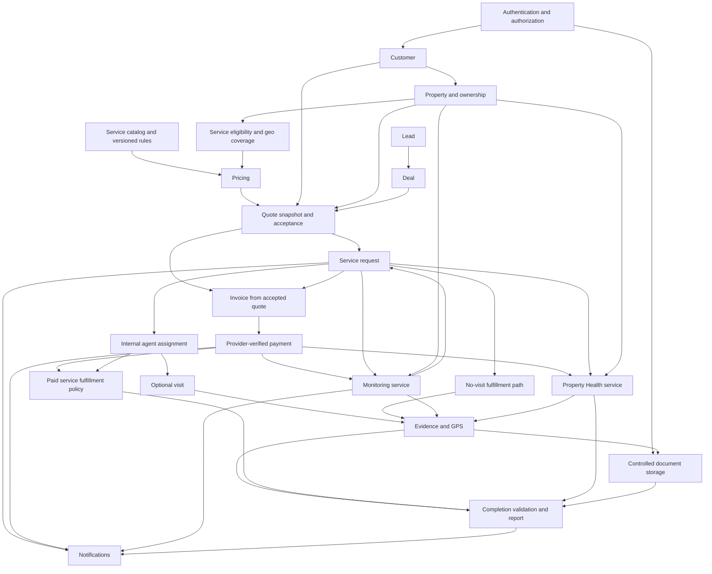

# PropertyPilot Implementation Sequence

**Purpose:** Execution roadmap for the approved Release Scope V1. Business Truth remains authoritative for product behavior; Architecture Truth guides domain boundaries; inventories and prior readiness documents describe current implementation evidence. This document orders only V1 work. It does not add business capabilities or authorize marketplace functionality.

Effort is in engineer-days. Ranges overlap where a shared contract or test is used by multiple work items. Timeline assumptions appear at the end.

## Executive Summary

### Recommended implementation strategy

Build and prove one PropertyPilot-owned, directly paid service path before widening the catalog. Start with production configuration and authorization because later customer flows depend on trustworthy actor and resource identity. Then establish catalog/coverage policy and price/quote acceptance, bind that quote to request and invoice, and connect provider-verified payment. Complete internal assignment, optional visit, controlled evidence and report delivery around the same request lifecycle. Add Monitoring and Property Health as bounded service configurations that reuse those foundations.

Deliver the browser customer and internal operations experience in parallel after API contracts stabilize. Keep the launch catalog, geographic coverage, automation and fulfillment capacity narrow. Use internal manual assignment and human review where the Release Scope allows it, but record actors and outcomes. Do not sell subscriptions in V1; disable unpaid renewal behavior.

### Critical path

Production secrets/schema policy → identity and resource authorization → service/coverage configuration → pricing rules and immutable quote acceptance → request and invoice derived from quote → verified payment → assignment and configured fulfillment → evidence and report → customer communication → production-like verification and pilot.

Monitoring and Property Health depend on the configured service, payment, request, evidence, notification and report foundations. They are bounded V1 offers, not separate platform silos.

### Highest-risk areas

- Payment is currently marked successful without provider confirmation; request amounts are caller supplied and no accepted quote is demonstrated.
- Resource ownership and assigned-agent authorization are inconsistent on requests, visits, evidence, invoices and payments.
- Evidence accepts caller-supplied URLs and has no demonstrated controlled storage/review boundary.
- Current customer/admin/operations clients are scaffold or demo roots, not usable launch channels.
- Monitoring and Property Health have persistence/reusable foundations but no end-to-end V1 workflows.
- Production configuration, restore/release controls and production-path integration gates have not been proven.

## Phase 0 – Production Blockers

| Item | Description | Why it blocks launch | Affected modules / likely code areas | Estimated effort | Dependencies |
|---|---|---|---|---:|---|
| P0.1 Production configuration | Externalize and rotate JWT secrets; production profile must disable schema auto-update and debug SQL/security logs; make Flyway the schema writer; use least-privilege credentials. Likely files: `propertypilot-backend/src/main/resources/application.yml`, `application-prod.yml`, `application-dev.yml`, `security/JwtService.java`, database migration configuration. | The current base settings can expose signing material/log data and permit uncontrolled production schema changes. | Authentication, database, deployment | 2–4 days | Hosting/environment and secret owner; begin immediately. |
| P0.2 Identity and authorization foundation | Establish route/role/resource policy; derive actor and customer from the principal; enforce ownership/assignment for customer, property, request, visit, evidence, document, quote, invoice and payment; align route prefixes and `ROLE_` checks. Likely files: `config/SecurityConfig.java`, `security/SecurityService.java`, `security/CustomUserDetailsService.java`, affected web controllers and service implementations. | A customer or agent must not access or mutate another customer’s property/work or financial records by changing IDs. | Authentication, customer/property, request, field operations, evidence, billing/payment | 6–12 days | P0.1; agree role/resource matrix and shared-owner policy. |
| P0.3 Controlled object boundary | Replace arbitrary persisted file URLs with authorized storage references, upload validation, provenance and access logging; establish evidence acceptance state. Likely files: `EvidenceServiceImpl`, `DocumentServiceImpl`, evidence/document DTOs/entities and controllers; object storage adapter/configuration. | Property documents and field proof are sensitive customer data and underpin completion/payment trust. | Evidence, documents, Health, reports | 8–14 days | P0.2; choose storage, file limits and retention. |
| P0.4 Production deployment and recovery | Establish production runtime/health checks, alerts and ownership, backups, restore rehearsal, release and rollback procedure. Likely files: backend `Dockerfile`, application profiles, Actuator configuration, deployment manifests/CI/runbooks; development `docker-compose.yml` must not be production configuration. | A launch cannot protect customer/property/payment data without repeatable deployment and demonstrated recovery. | Deployment, database, all modules | 5–9 days | P0.1; hosting, RPO/RTO and operations owner. |
| P0.5 Release test gate | Add and require PostgreSQL/Flyway migration, resource authorization, payment callback/idempotency, invoice consistency, evidence access, service completion, Monitoring/Health and recovery-path tests. Run and record the applicable suite in CI/pre-production. | Unit-test file counts do not establish that the integrated customer transaction and data boundary work. | All V1 modules | 8–14 days | P0.1–P0.3 contracts; payment sandbox and PostgreSQL environment. Tests are implemented alongside the phases below, not postponed to the final week. |
| P0.6 Usable customer and operations channel | Replace scaffold React pages/configuration with a responsive web flow for customer onboarding/property/quote/request/payment/status/report and minimum internal catalog/lead/deal/assignment/evidence operations. Likely areas: `propertypilot-frontend/src/**`, `package.json`, `vite.config.ts`, `tsconfig*`, backend controllers/contracts. | The current repository has no usable customer or staff application through which to sell and deliver the service. | Customer, property, catalog, CRM, request, operations, reporting | 20–40 days | API/auth/quote contracts from P0.2 and Phase 1; UI skeleton can start in parallel. |

## Phase 1 – Revenue Path

The target is the Release Scope V1 transaction: **Customer → Quote → Acceptance → Service Request → Assignment → optional Visit → Evidence → Invoice → Payment**. The order below makes no assumption that all services require a visit. Entities/services/controllers are likely affected areas identified by the inventories; class names for new V1 workflow paths should be added only within the existing domains.

### 1. Customer and property transaction context

- **Module:** Customer Management and Property Management
- **Purpose:** Ensure the authenticated customer can select an authorized property, and staff can create/manage a customer where needed. Every ordinary service request must have correct customer/property ownership.
- **Affected entities:** `CustomerEntity`, `UserEntity`, `Property`, `PropertyOwnerEntity`, `PropertyLocationEntity`.
- **Affected services:** `AuthServiceImpl`, `UserServiceImpl`, customer profile/onboarding services, `PropertyServiceImpl`, `PropertyOwnerServiceImpl`, `SecurityService`.
- **Affected controllers:** `AuthController`, `UserController`, `PropertyController`, `PropertyOwnerController`, customer profile/address/verification controllers as used by the selected onboarding flow.
- **Dependencies:** Phase 0 identity/authorization policy and production secret handling.
- **Effort:** 4–8 days backend plus client integration time included in P0.6.

### 2. Launch service configuration and coverage

- **Module:** Service Catalog and minimum Geo Intelligence
- **Purpose:** Define the small V1 catalog and one sellable coverage area: eligibility, availability, tax/pricing profile reference, SLA, optional visit, evidence/GPS rules and completion outputs. Configuration must be applied to both visiting and non-visiting services.
- **Affected entities:** `ServiceEntity`, `ServiceEligibilityRuleEntity`, `ServicePriceRuleEntity`, `ServiceSlaPolicyEntity`, `CoverageZoneEntity`, `ClusterEntity`, `PropertyLocationEntity`, agent territory/location entities.
- **Affected services:** `EligibilityEngineImpl`, pricing rule/profile services, `GpsVerificationServiceImpl`; add missing catalog/coverage operations within these existing domains where necessary.
- **Affected controllers:** No coherent service catalog controller or zone/cluster admin controller is identified. Likely extend an existing admin/configuration controller or add controllers inside the existing service-catalog/geo domains; do not create a new product module. Existing relevant endpoints include `PricingConfigurationController`, `PricingRuleController`, and `GpsVerificationController`.
- **Dependencies:** Customer/property context; agree launch area and exact service policies in Release Phase 1.
- **Effort:** 5–9 days.

### 3. Rule-driven pricing and quote acceptance

- **Module:** Pricing Engine and Quote Management
- **Purpose:** Calculate a customer-visible price from PropertyPilot-controlled, versioned rules and persist immutable quote/line snapshots. Customer acceptance and expiry must be explicit. V1 uses approved direct-service pricing; subscription entitlements remain disabled.
- **Affected entities:** `PricingEstimateEntity`, pricing profile/parameter/rule/discount entities, quote-line entity/entities, service/customer/property references.
- **Affected services:** `PricingRuleEngineServiceImpl`, `PricingCalculatorServiceImpl`, pricing profile/configuration/history services; quote acceptance/expiry behavior in the current pricing domain.
- **Affected controllers:** `PricingController`, `PricingRuleController`, `PricingConfigurationController`; extend the current pricing API for quote create/read/accept if no existing quote operation meets the contract.
- **Dependencies:** Step 2 service, coverage and tax inputs; Phase 0 security. Product/finance approves rounding and price display.
- **Effort:** 8–14 days.

### 4. Quote-backed service request creation and state ownership

- **Module:** Service Request
- **Purpose:** Convert an accepted quote into a property-linked work order; reject caller-supplied amount/identity; apply eligibility and frozen service policy; make lifecycle transitions auditable and valid.
- **Affected entities:** `ServiceRequestEntity`, `ServiceRequestStatusHistoryEntity`, service/customer/property references, assignment references, quote/estimate relationship.
- **Affected services:** `ServiceRequestServiceImpl`, eligibility service, `SecurityService`; consolidate the currently overlapping request/assignment lifecycle behavior in this domain or its existing workflow boundary.
- **Affected controllers:** `ServiceRequestController`; create/status/update DTOs such as `CreateServiceRequestRequest` and admin status/assignment requests.
- **Dependencies:** Steps 1–3; Phase 0.2; a stable accepted-quote contract.
- **Effort:** 5–9 days.

### 5. Internal agent assignment

- **Module:** Agent Assignment
- **Purpose:** Allow authorized operations staff to assign/reassign and agents to accept/reject only their work. Assignment is internal fulfillment; the customer continues to buy from PropertyPilot.
- **Affected entities:** `AgentAssignmentEntity`, agent/skill/territory entities, `ServiceRequestEntity`, assignment status history if present.
- **Affected services:** `AgentAssignmentServiceImpl`, `ServiceRequestServiceImpl`, `VisitServiceImpl`; remove lifecycle ambiguity and throwing methods only after consumers move to the canonical flow.
- **Affected controllers:** No dedicated assignment controller is identified. Existing request admin assignment path (including `AdminAssignServiceRequestRequest`) and agent endpoints are likely integration points; add missing methods to the existing operations controller/domain as needed.
- **Dependencies:** Step 4; P0.2 agent identity/access; Step 2 coverage and capability rules.
- **Effort:** 4–8 days.

### 6. Optional visit lifecycle and configured completion rules

- **Module:** Visit Management and Completion Validation
- **Purpose:** Schedule and complete field visits only where the service requires them; enforce configured visit count and per-service/per-visit evidence/GPS expectations. No-visit services proceed through a valid non-visit completion route.
- **Affected entities:** `VisitEntity`, `AgentAssignmentEntity`, `ServiceRequestEntity`, service policy, status history.
- **Affected services:** `VisitServiceImpl`, `CompletionValidationServiceImpl`, `ServiceRequestServiceImpl`.
- **Affected controllers:** `VisitController`, `ServiceRequestController`, `GpsVerificationController`.
- **Dependencies:** Steps 2, 4 and 5; Phase 0.2. Controlled evidence integration follows in Step 7; tests should be added now with the completion contract.
- **Effort:** 3–6 days.

### 7. Evidence and document capture, review and report input

- **Module:** Evidence Management and Document Management
- **Purpose:** Capture configured proof with secure object references, validated metadata, authorized upload/download and provenance. Only accepted required evidence satisfies completion. Property/service documents use the same secure storage boundary.
- **Affected entities:** `EvidenceEntity`, evidence type, GPS verification, `Document`, `DocumentVersion`, `PropertyDocumentEntity`, visit/request/property references.
- **Affected services:** `EvidenceServiceImpl`, `GpsVerificationServiceImpl`, `DocumentServiceImpl`, `CompletionValidationServiceImpl`.
- **Affected controllers:** `EvidenceController`, `GpsVerificationController`, `DocumentController`, `ReportController` as evidence links are presented.
- **Dependencies:** Step 6 contracts; Phase 0.2/P0.3 authorization and storage decisions; Step 2 frozen evidence/GPS rules.
- **Effort:** 8–14 days.

### 8. Quote-derived invoice and provider-verified payment

- **Module:** Billing / Invoice and Payment Integration
- **Purpose:** Create an invoice only from the accepted quote; use unique invoice numbering and approved tax/currency; mark paid only from verified provider state; make retries idempotent and refunds auditable. V1 only exposes supported direct-service payment; disable unsafe subscription renewal.
- **Affected entities:** `InvoiceEntity`, `PaymentEntity`, `RefundEntity`, `PricingEstimateEntity`/quote lines, `ServiceRequestEntity`.
- **Affected services:** `BillingServiceImpl`, `PaymentServiceImpl`, `DealBillingServiceImpl` only where it overlaps service invoices; renewal services/scheduler must be disabled or prevented from marking success without payment.
- **Affected controllers:** `BillingController`, `PaymentController`, `PricingController` or quote API for checkout initiation and payment status; provider callback endpoint within the payment domain.
- **Dependencies:** Steps 3–4; Phase 0.1–0.2; provider selection, sandbox, finance policy and callback secret. Provider selection can begin in Phase 0; integration must consume stable quote/invoice contracts.
- **Effort:** 13–24 days including quote-to-invoice integrity and provider integration; do not add this range to the overlapping foundational pricing item mechanically.

### 9. Revenue handoff through leads and deals

- **Module:** Lead Management and Deal Management
- **Purpose:** Provide minimal staff sales intake and accepted deal conversion to one or more quote-backed service requests, keeping source attribution and preventing duplicate conversion.
- **Affected entities:** `LeadEntity`, `LeadActivityEntity`, deal/activity/milestone/participant entities, `DealServiceRequestLinkEntity`, `CustomerEntity`, service request/quote references.
- **Affected services:** `LeadServiceImpl`, `LeadActivityServiceImpl`, `DealServiceImpl`, `DealBillingServiceImpl`, `ServiceRequestServiceImpl`.
- **Affected controllers:** `LeadController`, `DealController`, `ServiceRequestController`.
- **Dependencies:** Steps 1, 3–4; P0.2; accepted-deal conversion policy. Can run alongside visit/evidence work after quote/request contract is stable.
- **Effort:** 3–6 days for minimal reliable conversion; avoid broad CRM automation.

## Phase 2 – Operational Stability

| Item | Purpose | Likely affected areas | Dependencies | Effort |
|---|---|---|---|---:|
| Notifications | Deliver template-driven in-app, email and SMS for request, payment, assignment, visit, completion, Monitoring/Health outputs and operational failures; persist provider result/retry/deduplication. | `NotificationEntity`, `NotificationTemplateEntity`, subscription notification persistence as reusable only; notification service/provider adapter; reminder scheduler; assignment/request/payment/monitoring/health event publishers; subscription reminder code must not imply active V1 plans. | Phase 1 state/event contracts, P0.4 operations ownership; provider credentials/templates. | 5–9 days |
| Geo enforcement | Enforce the chosen sellable service area and agent territory, travel-price inputs and configured GPS acceptance. Do not build multi-city route optimization. | `CoverageZoneEntity`, `ClusterEntity`, `PropertyLocationEntity`, geography repositories, agent territory records, `EligibilityEngineImpl`, pricing services, `GpsVerificationServiceImpl`; catalog/geo admin endpoints. | Phase 1 catalog and property location; pricing and visit/GPS policy. | 3–6 days beyond catalog setup |
| Monitoring workflow | Make one paid Monitoring offer operational: activate schedule from request/payment, run or record observations, capture evidence, human review, customer alert, optional linked follow-on service request, pause/expiry and idempotent reruns. | `MonitoringScheduleEntity`, `MonitoringAlertEntity`, monitoring repositories; no workflow service/controller/scheduler is identified; existing `ServiceRequestServiceImpl`, `EvidenceServiceImpl`, notification/report domains are integration points. | Phase 1 catalog, accepted quote/payment, request lifecycle, evidence/document boundary; notifications and geo policy as needed. | 8–15 days |
| Property Health workflow | Deliver one configured checklist as a service: collect allowed documents/visit evidence, record checks/findings, explain score/risk result and create the Health report. | Reuse `ServiceEntity`, service request, `Document`/`DocumentVersion`, evidence/GPS, report entities and repositories; no dedicated assessment service/controller/DTO family is identified. Extend the existing service/report domains rather than create a separate platform module. | Phase 1 pricing/request, completion and evidence/document policies; report output and approved checklist/score. | 6–12 days |
| Operational/customer reporting | Make completion report, Health report and Monitoring observation/alert history available only to authorized customers; provide staff-visible stuck/SLA/payment status needed for manual pilot operations. | `ReportEntity`, `ReportReviewEntity`, `ReportServiceImpl`, `CompletionValidationServiceImpl`, `ReportController`, customer dashboard service/controller and request/visit/evidence read models. | Phase 1 completion/evidence/payment; Monitoring/Health output contract; P0.2 access rules. | 4–8 days backend, client work shared with P0.6 |
| Customer support intake | Provide a PropertyPilot-owned complaint/support intake, owner and response target; use manual escalation/remediation at V1 scale. | Existing complaint/comment/SLA persistence candidates and customer-facing operations/API; audit and notification hooks. No end-to-end complaint controller/service is identified. | P0.2 identity/access, notification base, request/report links and assigned staff ownership. | 3–6 days for basic intake; automated multi-level SLA escalation remains deferred. |

## Phase 3 – Production Hardening

This phase is cross-cutting. Start its test, audit and telemetry work alongside earlier phases; the listed order is the final production sign-off sequence.

| Work item | Purpose | Risk if not implemented | Likely code areas | Effort |
|---|---|---|---|---:|
| Authorization closure | Review every V1 endpoint and service for customer, property, agent, admin and payment-provider access; test cross-resource denial and principal-derived actors. | Customer data disclosure, forged work activity, unauthorized charges/refunds or evidence access. | `SecurityConfig`, `SecurityService`, `CustomUserDetailsService`, relevant controllers and service implementations. | 4–8 days beyond initial P0.2 implementation for V1 review/remediation |
| Audit trail and actor/reason | Ensure request, assignment, visit, evidence review, quote acceptance, invoice/payment/refund, Monitoring/Health results and admin rule changes record authenticated actor, time, change and reason. | Service disputes and financial changes cannot be reconstructed; violates Business Truth’s audit requirement. | `AuditableEntity`, status-history/activity entities, request/lead/deal/payment/evidence/configuration services. | 5–9 days |
| Evidence security verification | Verify file allowlist/limits, malware/content validation policy, object access expiry, retention, deletion, checksums and access auditing for the selected storage provider. | Malicious uploads, leaked documents, unverifiable proof or retention violations. | Document/evidence services, storage adapter, DTOs, access policy and production configuration. | 2–5 days beyond P0.3 implementation |
| Input validation and state contracts | Add consistent DTO validation for quote/request/payment/visit/evidence/customer inputs; reject illegal transitions with stable client error semantics. | Invalid amounts/IDs/states, confusing retries and brittle client behavior. | Request/evidence/payment/quote DTOs and controllers, service transition validators, API error handlers. | 4–8 days |
| Error handling and idempotency | Normalize API errors, provider webhook retries, duplicate request/deal conversion, schedule reruns and notification delivery; ensure transaction boundaries/rollback. | Duplicate charges/work, stuck workflows and unhandled provider failures. | Payment and request services, deal conversion, scheduler/outbox/event integration, exception handling. | 4–8 days beyond payment integration; overlap with P0.5 tests |
| Observability and operational logging | Add structured correlation IDs and health/metrics/log fields for request-to-payment, provider reconciliation, SLA delays, Monitoring runs, evidence failures and notification delivery. Avoid secrets/PII in logs; production log level must be safe. | Failures remain invisible; sensitive information may leak; staff cannot resolve stuck work. | Spring logging configuration, Actuator/metrics, provider adapters, schedulers and operations dashboards/alerts. | 4–7 days |
| Deployment readiness and recovery | Validate production profile, Flyway migration/upgrade, non-root runtime, secrets, network/data access, probes, CI release gates, backup restore, rollback and incident ownership. | Outage, data loss, unsafe deployment or inability to recover customer/payment records. | `application*.yml`, Docker/deployment configuration, CI workflows, Flyway migrations, runbooks and alert setup. | 5–9 days, with P0.1/P0.4 foundations shared |
| Performance and bounded operations | Paginate customer/admin lists and batch evidence/GPS completion lookups; size DB pools and verify expected pilot load. | Increasing response time or memory/query pressure can interrupt service delivery. | Billing/report/customer list services and repositories, completion queries, DB pool/runtime config. | 3–6 days for launch load; broader tuning deferred |

## Module Dependency Graph

The graph represents logical dependencies, not separate deployable services. Payment timing must follow the selected commercial policy (normally pay before fulfillment); an invoice may exist before payment. No-visit services skip Visit while retaining request, evidence/document, completion and report policy as applicable.

## Exact Recommended Build Order

1. Confirm Phase 1 launch offers, coverage, prices/tax/refund policy, visit/evidence/GPS rules, capacity and report promises; select payment, storage, email/SMS and hosting providers.
2. Fix production profile, JWT secret handling, Flyway/Hibernate ownership, safe logging and least-privilege database configuration.
3. Implement the resource/role matrix and principal-derived actor/customer/agent identity; add negative authorization tests on property and existing ownership paths.
4. Establish secure object storage and scoped document/evidence upload/download; define accepted-evidence status and audit metadata.
5. Make service catalog and one-area geo eligibility configurable for the selected offers; snapshot policy versions used by each request.
6. Complete PropertyPilot pricing rules and persisted quote/line snapshot; add quote expiry and acceptance with customer-visible total/benefits.
7. Change service request creation to consume accepted quotes and owned properties; enforce legal transitions and status history.
8. Create unique, quote-derived invoices with approved tax/currency; implement provider-verified payment, idempotency, webhook verification, reconciliation and supported refund states.
9. Disable or guard V1 subscription/auto-renew endpoints and scheduler paths so none can represent unpaid entitlement as active.
10. Consolidate assignment ownership and implement internal assign/reassign/agent accept-reject with resource authorization.
11. Enforce optional visit and visit-count policy; implement no-visit completion; apply GPS and per-service/per-visit evidence checks.
12. Complete evidence review and completion/report generation; verify customer access to own records only.
13. Build and connect the responsive web customer and operations channel against the stable auth, quote, request and payment contracts; maintain parallel UI skeleton work from step 2 onward.
14. Implement transactional notifications and support intake; provide staff visibility into failed payments, stuck requests and missed SLAs.
15. Deliver one Monitoring service workflow and its alert/evidence/follow-on-request path using the established service flow.
16. Deliver one Property Health checklist workflow, explainable result and report using the same service flow.
17. Complete minimal lead/deal intake and idempotent accepted-deal-to-quote/request handoff; this can proceed alongside steps 10–16 after request/quote contracts settle.
18. Add final integration tests for direct purchase, visit and no-visit services, Health and Monitoring outcomes, notification retries, refunds, access denial and migration upgrade; require passing CI gates.
19. Rehearse production deploy, backup restore, rollback, payment reconciliation, support escalation and agent operations with pilot staff.
20. Launch to the constrained cohort/area; review payment reconciliation, contribution margin, SLA, completion evidence, reports and support load before widening catalog or geography.

## Estimated Timeline

Person-day scope is based on the Release Scope V1 estimates: 100–150 days minimum pilot, 135–205 stable launch, and 165–250 high-confidence production launch. It includes a bounded Monitoring offer and one Health Check, browser customer/operations channel, direct service payments, tests and deployment/recovery. It excludes subscriptions, native mobile, broad multi-city expansion, AI and enterprise packages.

| Scenario | Elapsed estimate | Assumptions |
|---|---:|---|
| Solo developer | **5–8 months** | One experienced full-time engineer; provider selection and business decisions arrive promptly; product/design and operations support are available part-time. External integration waits can extend this. |
| Small team | **12–18 weeks** | 3–4 engineers with backend, web, QA/automation and part-time operations/security support; work is parallelized after contracts settle. Shared review and integration time remains. |
| Optimistic | **8–10 weeks** | 4–5 experienced contributors, simple provider integrations, clear catalog/policies, no major legacy data migration, existing hosting account and few integration defects. This is a best case, not a commitment. |
| Realistic | **14–20 weeks** | 3–4 contributors, full V1 workflow and regression hardening, provider/hosting coordination, some rework from integration findings and production-like rehearsal. |

## Launch Readiness Milestones

### M1 — Offer, security and contracts ready

- **Deliverables:** Narrow V1 catalog/coverage/pricing/service policy decisions; production-safe secret and schema configuration; resource/role matrix; stable API contracts for quote, request, document/evidence and payment.
- **Success criteria:** Production configuration has no committed signing secret or schema auto-update; authenticated customer/agent/admin identities are enforced; launch offers have approved prices, tax, service outcomes and fulfillment owners; cross-customer access tests pass.

### M2 — One-time revenue transaction works

- **Deliverables:** Customer/property selection, configured service, quote snapshot/acceptance, quote-backed request/invoice, provider payment, internal assignment and customer transaction status.
- **Success criteria:** In a production-like environment, a customer can accept a displayed quote and pay once; retries do not double-charge; client input cannot change price/customer/property; provider confirmation alone settles the invoice.

### M3 — V1 services fulfill with proof

- **Deliverables:** Visit and no-visit execution, secure evidence/document lifecycle, completion validation/report, one Monitoring offer, one Property Health offer, customer notices and support intake.
- **Success criteria:** A visit-required and a no-visit service each reach valid completion; required evidence and access boundaries are enforced; Monitoring alert and Health report link to the property/request and are customer-visible only to authorized users; operational messages and support ownership are recorded.

### M4 — Controlled pilot release approved

- **Deliverables:** Working customer/operations web client; passing PostgreSQL/Flyway and integration gates; production deployment, alerts, backup restore and rollback rehearsal; trained launch staff and agents.
- **Success criteria:** CI release gates pass; restore and rollback are demonstrated; provider settlement reconciles; support/escalation and fulfillment rehearsal completes; launch area, customer cohort, prices and service capacity are explicitly capped and monitored.

## Final Recommendation

If development resumes tomorrow, start by making the **service transaction boundary safe and priceable**, not by adding catalog breadth.

- **First module:** Authentication & Security, focused on principal-derived customer/property identity and resource authorization; simultaneously lock the exact one-area launch offer/policy decisions with product and operations.
- **First service:** `PricingRuleEngineServiceImpl` plus `PricingCalculatorServiceImpl`, producing a versioned, persisted quote from the selected service/property/coverage rules. This is the earliest revenue-specific contract, but should begin only after the ownership and configuration inputs are defined.
- **First controller:** `PricingController`, to expose the accepted quote contract after the principal/ownership policy and service inputs are defined. Then update `ServiceRequestController` so request creation consumes that accepted quote and an authorized property. The React client can begin its shell in parallel against these agreed contracts.
- **First workflow:** authenticated customer selects an owned property and configured service → receives and accepts a quote → creates a request → receives a provider-confirmed invoice payment. Then extend that same request through internal assignment, optional visit, evidence and report before broadening offers.

This sequence creates the transaction foundation used by direct service revenue, Monitoring and Property Health while preserving PropertyPilot as the sole customer-facing service owner.
