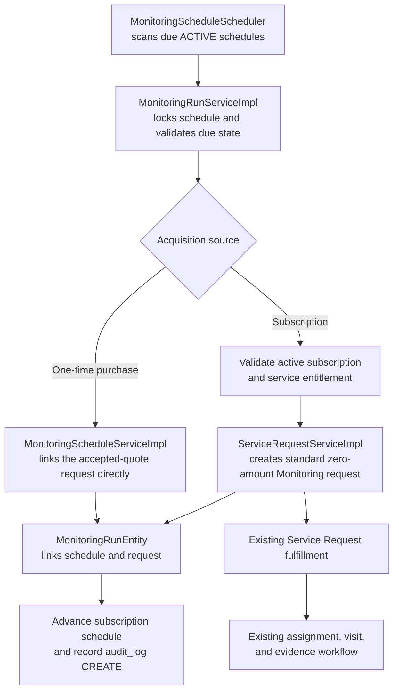

# Phase 1 Monitoring Foundation Review

Reviewed the current source, migration, monitoring tests, and generated Surefire reports. No code was changed. The flow links monitoring cycles to the existing Service Request workflow; it does not create visits or evidence directly.

## 1. `MonitoringRunEntity`

[`MonitoringRunEntity.java`](propertypilot-backend/src/main/java/com/propertypilot/infrastructure/persistence/entity/MonitoringRunEntity.java) records one cycle for a monitoring schedule.

| Field | Purpose |
|---|---|
| `monitoringRunId` | UUID primary key |
| `monitoringSchedule` | Required lazy `ManyToOne` to the schedule |
| `serviceRequest` | Required lazy `OneToOne` to the canonical service request |
| `runNumber` | Sequence number within the schedule |
| `cycleKey` | Stable cycle identifier used to prevent duplicate runs |
| `scheduledFor` | Due time for the cycle |
| `startedAt` | Time the run record was created |
| `runStatus` | Currently fixed to `SERVICE_REQUEST_LINKED` |
| `version` | Optimistic-lock field |
| Inherited audit fields | From `AuditableEntity` |

The entity and migration make the run record immutable. Its purpose is to preserve the history and identity of each monitoring cycle while fulfillment continues through the standard service request.

## 2. `MonitoringScheduleEntity` changes

[`MonitoringScheduleEntity.java`](propertypilot-backend/src/main/java/com/propertypilot/infrastructure/persistence/entity/MonitoringScheduleEntity.java) now supports either subscription-based monitoring or a one-time purchased monitoring request:

- `customerSubscription` is optional.
- `sourceServiceRequest` is a new optional link to the one-time purchase request.

The schedule still holds the property, monitoring service, frequency, next due time, status, last generation time, and version. The database migration enforces that exactly one of subscription or source request is set. This accommodates both acquisition paths without adding a separate schedule table.

## 3. Flyway migration

[`V033__monitoring_run_foundation.sql`](propertypilot-backend/src/main/resources/db/migration/V033__monitoring_run_foundation.sql):

**Creates:** `monitoring_runs`.

**Changes:** makes the schedule’s subscription reference nullable, adds its source service request reference, replaces the old frequency check with an acquisition-source check, and changes subscription/property deletion behavior to `RESTRICT` to preserve linked schedule history.

**Indexes:**

- `uq_monitoring_schedule_purchase_request`: at most one schedule per non-null purchase request.
- `idx_monitoring_runs_schedule_history`: schedule and run number.
- `idx_monitoring_runs_request`: service request lookup.

**Constraints:**

- Foreign keys to schedules, service requests, subscriptions, properties, and users.
- Unique schedule/run number, schedule/cycle key, and service request links.
- Positive run number.
- Run status restricted to `SERVICE_REQUEST_LINKED`.
- Audit timestamp/version consistency.
- A trigger rejects updates and deletes to monitoring-run rows.

The migration was inspected in source; the test results do not show that it was applied to a PostgreSQL database.

## 4. APIs

All endpoints are in [`MonitoringScheduleController.java`](propertypilot-backend/src/main/java/com/propertypilot/web/controller/MonitoringScheduleController.java).

| Endpoint | Access | Request / Response | Purpose |
|---|---|---|---|
| `POST /api/v1/monitoring/schedules` | `ADMIN`, `OPERATIONS` | `CreateMonitoringScheduleRequest` → `MonitoringScheduleResponse` | Create a subscription or one-time schedule; a one-time request immediately gets its initial run linked. |
| `GET /api/v1/monitoring/schedules/me` | `CUSTOMER` | No body → list of schedule responses | Return the current customer’s schedules. |
| `GET /api/v1/monitoring/schedules/{scheduleId}` | `CUSTOMER`, `ADMIN`, `OPERATIONS` | No body → schedule response | Read one schedule. Service-layer ownership validation is applied. |
| `GET /api/v1/monitoring/schedules/{scheduleId}/runs` | `CUSTOMER`, `ADMIN`, `OPERATIONS` | No body → list of run responses | Read run history; service-layer ownership validation is applied. |
| `POST /api/v1/monitoring/schedules/{scheduleId}/run-due` | `ADMIN`, `OPERATIONS` | No body → run response or `204 No Content` | Attempt a due run immediately. Returns no content if no run is created. |

The create request fields are `customerSubscriptionId`, `sourceServiceRequestId`, `propertyId`, `serviceId`, `frequency`, and optional `firstDueAt`. The service rejects requests that provide both acquisition IDs or neither. Responses expose schedule/run identifiers, linked request ID, timing, frequency, and status.

## 5. Monitoring execution flow

The main classes are `MonitoringScheduleScheduler`, `MonitoringRunServiceImpl`, and `ServiceRequestServiceImpl`:

For subscription cycles, [`MonitoringScheduleScheduler.java`](propertypilot-backend/src/main/java/com/propertypilot/application/scheduler/MonitoringScheduleScheduler.java) invokes `processDueSchedules()`. That method handles schedules in separate transactions; `runScheduleIfDue()` locks the schedule, checks entitlement and the previous request’s completion, creates a request through `createEntitledMonitoringRequest()`, writes the run record, advances the schedule, and records an audit entry.

For one-time monitoring, schedule creation validates the source request and links that same request to the initial `MonitoringRunEntity`; it does not create a duplicate request. The schedule is then marked `COMPLETED`.

A run therefore means “a monitoring cycle was linked to a service request.” It does not mean the visit or service work has completed. Visits and evidence remain in the existing fulfillment workflow.

## 6. Test coverage

Monitoring-specific tests are unit tests:

- [`MonitoringConfigurationServiceImplTest.java`](propertypilot-backend/src/test/java/com/propertypilot/application/service/impl/MonitoringConfigurationServiceImplTest.java): 3 tests for ISO period normalization, positive/malformed frequency validation, date arithmetic, and monitoring-service validation.
- [`MonitoringRunServiceImplTest.java`](propertypilot-backend/src/test/java/com/propertypilot/application/service/impl/MonitoringRunServiceImplTest.java): 2 Mockito tests for subscription run creation and reuse of the one-time source request.

The latest generated Surefire reports show **586 tests across 85 suites, 0 failures, 0 errors, and 0 skipped**. There are no monitoring-specific integration or controller HTTP tests. A JaCoCo execution file exists, but no HTML/XML report was present, so I could not verify a line or branch coverage percentage.

## 7. Production readiness concerns

- **Run status only records request linkage.** There is no run lifecycle for fulfillment started, completed, failed, or retried. `startedAt` is set when the run record is created, not when a visit begins.
- **No entitlement consumption is recorded.** The subscription path checks for an active plan entitlement, but this implementation does not consume a quantity or ledger entry. It creates the request with amount zero.
- **One-time payment is not verified here.** The one-time path checks for an accepted quote and eligible request status; this flow does not verify invoice settlement.
- **No missed-run notification or rescheduling policy is wired into this foundation.** Failed processing is logged and left due for a later scan, but repeated failures have no backoff or operational escalation.
- **Due-schedule scans are unbounded.** The repository returns all due active schedules; there is no batch limit in this implementation.
- **Integration behavior remains unverified.** The monitoring tests mock repositories and transactions; they do not exercise migration application, database locking, uniqueness constraints, immutability trigger behavior, or API authorization over HTTP.
- **Schedule creation is staff-only.** Customers can read their schedules but cannot create one through this controller. That relies on an operational process creating the schedule after purchase.

## 8. Assumptions reflected in the implementation

- A one-time monitoring service request funds exactly one monitoring run; its schedule is completed after that run is linked.
- Subscription schedule frequency is stored per schedule as a positive ISO-8601 `Period` (for example, `P15D` or `P3M`), rather than selected from a versioned frequency catalog.
- An active subscription entitlement is sufficient to create a zero-amount monitoring request; entitlement usage accounting is handled elsewhere or deferred.
- `SERVICE_REQUEST_LINKED` is the intended completion boundary for Phase 1’s run record. Actual service completion remains represented by the linked service request lifecycle.
